<a href="https://mohameddddt.github.io/">
  <picture>
    <source media="(prefers-color-scheme: dark)" srcset="assets/banner-dark.svg">
    
  </picture>
</a>

  
  
  
  

I'm in my fourth year at ENSIA, the National Higher School of Artificial Intelligence in Algiers, working mostly on machine learning, computer vision and NLP. I like projects that end in something you can use: a forecast you can pick a fantasy team with, a route planner you can watch fly, a music player on your phone. I also care about honest evaluation, so most of the numbers below come from data the models never saw.

 

<picture>
  <source media="(prefers-color-scheme: dark)" srcset="assets/h-work-dark.svg">
  
</picture>

<table>
  <tr>
    <td width="50%" valign="top">
      <a href="https://fpl-assistant-ten.vercel.app">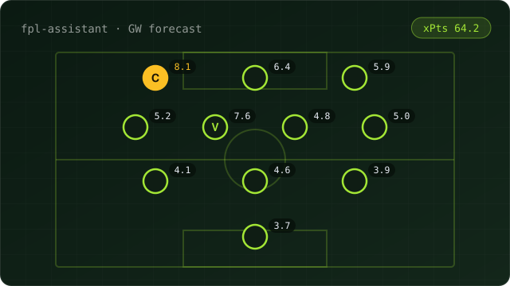</a>
      <h3>FPL Assistant</h3>
      Forecasts every Fantasy Premier League player's points for the next gameweek, then turns the forecasts into squads, transfers and captain picks.
      
<b>+0.12 to +0.15 R²</b> over a five-match average on 50,000 held-out matches · Python · LightGBM

      <a href="https://fpl-assistant-ten.vercel.app">Live</a> · <a href="https://github.com/mohameddddt/fpl-assistant">Code</a>
    </td>
    <td width="50%" valign="top">
      <a href="https://github.com/mohameddddt/Drone-Based-Delivery-Optimization-Problem">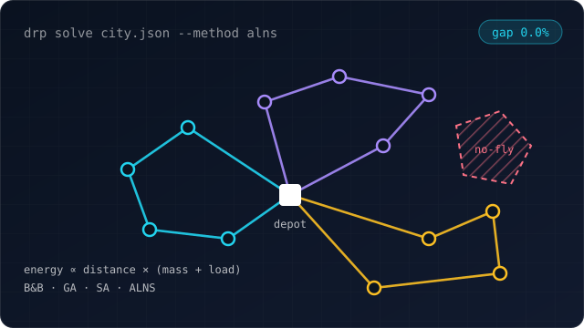</a>
      <h3>Drone Delivery Optimization</h3>
      Routes drones whose battery drain depends on the weight still on board: exact Branch &amp; Bound, GA / SA / ALNS, detours around no-fly zones, and a planner that replays the flight.
      
<b>624 tests</b>, 74 published CVRPLIB optima reproduced exactly · Python

      <a href="https://mohameddddt.github.io/Drone-Based-Delivery-Optimization-Problem/">Live</a> · <a href="https://github.com/mohameddddt/Drone-Based-Delivery-Optimization-Problem">Code</a>
    </td>
  </tr>
  <tr>
    <td width="50%" valign="top">
      <a href="https://github.com/mohameddddt/Speech-Emotion-Recognition">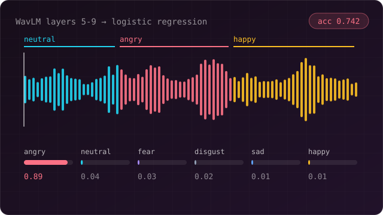</a>
      <h3>Speech Emotion Recognition</h3>
      Hears which of six emotions a spoken sentence carries, tested on voices the model never trained on. Hand-crafted acoustic features against a frozen WavLM encoder.
      
<b>74% accuracy</b> speaker-independent, vs 53% for the classical ensemble and 17% chance · PyTorch

      <a href="https://emotion-speach-recognition.netlify.app">Live</a> · <a href="https://github.com/mohameddddt/Speech-Emotion-Recognition">Code</a> · 
    </td>
    <td width="50%" valign="top">
      <a href="https://mohameddddt.github.io/eo-benchmark-hub/">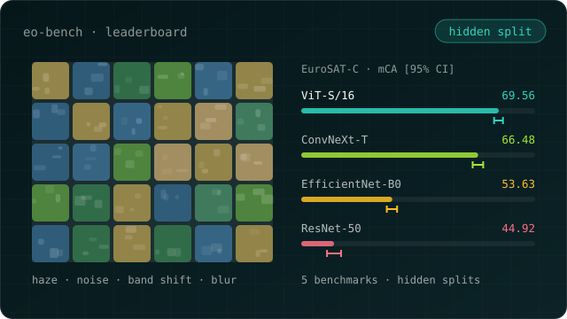</a>
      <h3>EO-Bench Hub</h3>
      Benchmarks Earth-observation models on hidden test splits across five datasets, with confidence intervals, robustness under sensor and haze corruptions, calibration and speed.
      
<b>Clean accuracy ties, robustness spreads 25 points</b> · PyTorch · FastAPI · React

      <a href="https://mohameddddt.github.io/eo-benchmark-hub/">Live</a> · <a href="https://github.com/mohameddddt/eo-benchmark-hub">Code</a>
    </td>
  </tr>
  <tr>
    <td width="50%" valign="top">
      <a href="https://mohameddddt.github.io/Streamline/">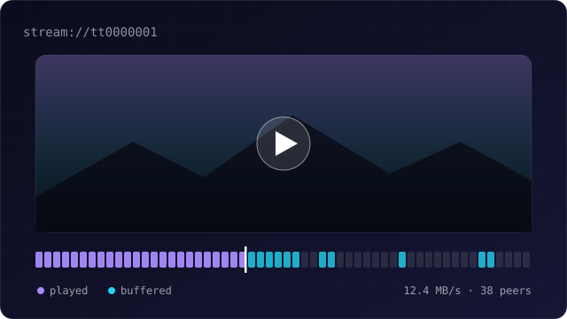</a>
      <h3>Streamline</h3>
      A movie and TV streamer for Windows and the web that speaks the Stremio addon protocol: smart source picking, next-episode autoplay, and Trakt / Simkl sync.
      
Electron · React · TypeScript · WebTorrent

      <a href="https://mohameddddt.github.io/Streamline/">Live</a> · <a href="https://github.com/mohameddddt/Streamline">Code</a>
    </td>
    <td width="50%" valign="top">
      <a href="https://github.com/mohameddddt/Cadence"></a>
      <h3>Cadence</h3>
      An Android music player and library manager: gapless local playback, fingerprint tagging with AcoustID and MusicBrainz, cover art, synced lyrics and scrobbling.
      
Flutter · Kotlin plugins

      <a href="https://github.com/mohameddddt/Cadence">Code</a>
    </td>
  </tr>
  <tr>
    <td width="50%" valign="top">
      <a href="https://github.com/mohameddddt/savepoint">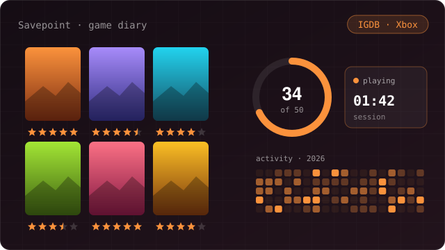</a>
      <h3>Savepoint</h3>
      A private game diary for Android: library, reviews, play-session timer, yearly goals and deep stats, with IGDB covers and Xbox history import.
      
Flutter · SQLite · IGDB API

      <a href="https://github.com/mohameddddt/savepoint">Code</a>
    </td>
    <td width="50%" valign="top">
      <a href="https://github.com/mohameddddt/Lumen">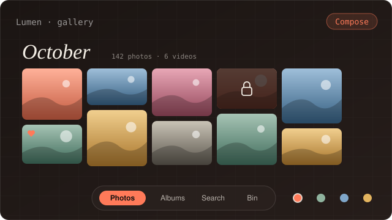</a>
      <h3>Lumen</h3>
      A calm, fast, offline gallery for Android with an editorial look: a pinch-to-resize timeline, custom albums, fingerprint-locked hidden folders and six palettes.
      
Kotlin · Jetpack Compose

      <a href="https://github.com/mohameddddt/Lumen/releases/latest">Download</a> · <a href="https://github.com/mohameddddt/Lumen">Code</a>
    </td>
  </tr>
  <tr>
    <td width="50%" valign="top">
      <a href="https://github.com/mohameddddt/Medical-literature-RAG-system">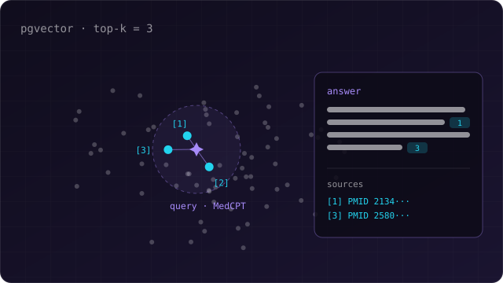</a>
      <h3>Clinical Evidence QA</h3>
      Answers clinical questions from PubMed abstracts and cites the sources every answer rests on, from a Flutter app.
      
MedCPT embeddings · Supabase pgvector · Node.js · Flutter

      <a href="https://github.com/mohameddddt/Medical-literature-RAG-system">Code</a>
    </td>
    <td width="50%" valign="top">
      <a href="https://somatrack-audit-web.onrender.com">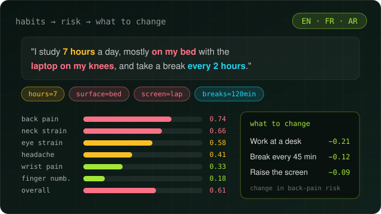</a>
      <h3>SomaTrack</h3>
      Turns a student's own description of their study habits into risk estimates for seven aches and strains, then suggests the changes that would lower them.
      
Seven per-target models · English, French, Arabic · FastAPI · React

      <a href="https://somatrack-audit-web.onrender.com">Live</a> · <a href="https://github.com/mohameddddt/SomaTrack-Predicting-Study-Related-Physical-Ailments">Code</a>
    </td>
  </tr>
  <tr>
    <td width="50%" valign="top">
      <a href="https://github.com/mohameddddt/mytube-invidious">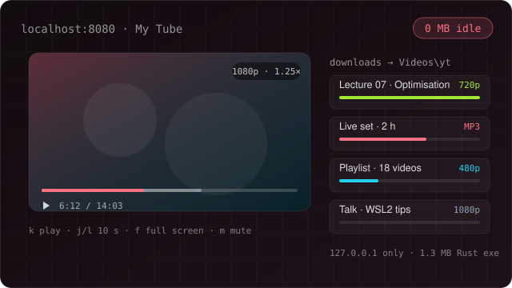</a>
      <h3>My Tube</h3>
      A self-hosted YouTube interface for Windows: Invidious in WSL2 under a light web app for search, account-free subscriptions and video or playlist downloads, run by one Rust exe in a WebView2 window.
      
<b>1.3 MB</b> single-file app, 0 MB while stopped · Rust · WebView2 · Docker · yt-dlp

      <a href="https://github.com/mohameddddt/mytube-invidious/releases/latest">Download</a> · <a href="https://github.com/mohameddddt/mytube-invidious">Code</a>
    </td>
    <td width="50%" valign="top">
      <a href="https://github.com/mohameddddt/Jerd">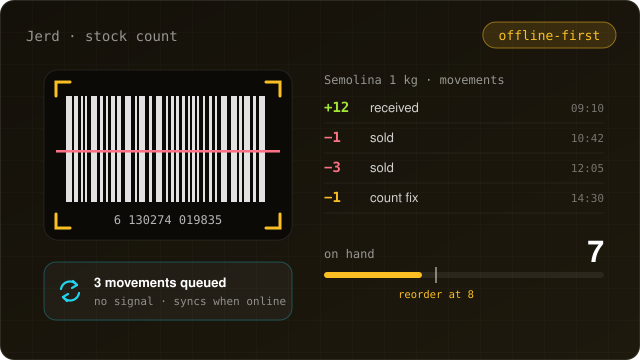</a>
      <h3>Jerd</h3>
      Offline-first stock control for a small shop: scan a barcode, log what came in or sold, and sync with the server when there is signal again.
      
Flutter · SQLite · Flask · push notifications

      <a href="https://github.com/mohameddddt/Jerd">Code</a>
    </td>
  </tr>
  <tr>
    <td width="50%" valign="top">
      <a href="https://github.com/mohameddddt/feather-pdf"></a>
      <h3>Feather PDF</h3>
      A fast PDF reader for Windows, drawn in plain Win32 and GDI on top of PDFium: contents sidebar, background search, text selection and dark mode, with no browser engine or UI framework.
      
<b>16 MB</b> with a 541-page book open, under 70 MB while reading · Rust · PDFium

      <a href="https://github.com/mohameddddt/feather-pdf/releases/latest">Download</a> · <a href="https://github.com/mohameddddt/feather-pdf">Code</a>
    </td>
    <td width="50%" valign="top">
      <a href="https://mohameddddt.github.io/work/almanac/">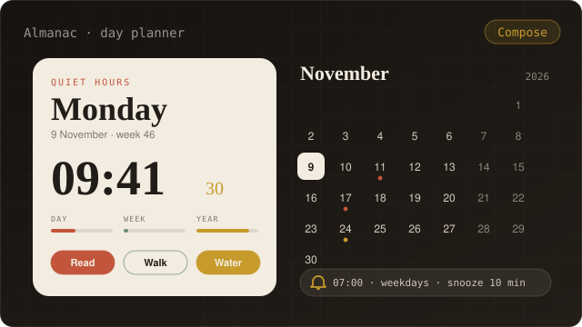</a>
      <h3>Almanac</h3>
      The whole day on one page for Android: a calendar, alarms with snooze, a timer and world clocks, tasks with priorities, and daily rituals with streaks, all offline.
      
Kotlin · Jetpack Compose · Material 3

      <a href="https://mohameddddt.github.io/work/almanac/">Screens</a>
    </td>
  </tr>
</table>

  

<picture>
  <source media="(prefers-color-scheme: dark)" srcset="assets/h-toolbox-dark.svg">
  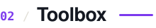
</picture>

<a href="https://mohameddddt.github.io/">
  <picture>
    <source media="(prefers-color-scheme: dark)" srcset="assets/toolbox-dark.svg">
    
  </picture>
</a>

Models first: gradient boosting, deep learning for audio, vision and text, retrieval and optimisation. Then whatever the model needs to be useful, on the web, mobile or desktop. I speak Arabic, French and English.

 

<picture>
  <source media="(prefers-color-scheme: dark)" srcset="assets/h-activity-dark.svg">
  
</picture>

<picture>
  <source media="(prefers-color-scheme: dark)" srcset="https://raw.githubusercontent.com/mohameddddt/mohameddddt/output/profile-3d-contrib/profile-night-rainbow.svg">
  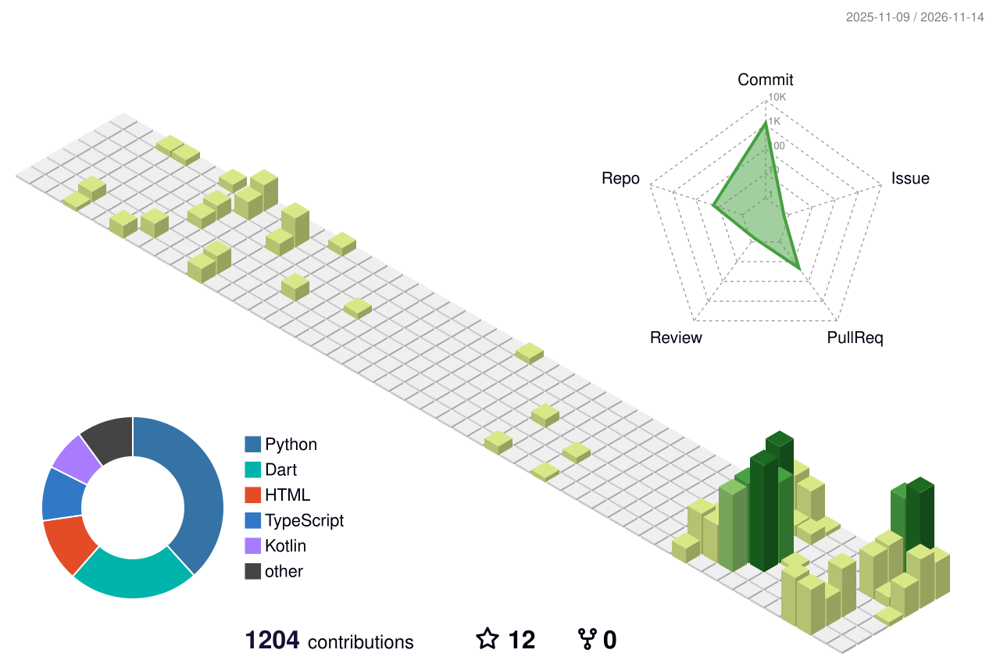
</picture>

 

<picture>
  <source media="(prefers-color-scheme: dark)" srcset="assets/h-hello-dark.svg">
  
</picture>

The quickest way to reach me is [mohamed.sahnoune.toubal@ensia.edu.dz](mailto:mohamed.sahnoune.toubal@ensia.edu.dz), or on [LinkedIn](https://www.linkedin.com/in/mohamed-sahnoune-toubal/). More about me and my work is on my [portfolio](https://mohameddddt.github.io/).
