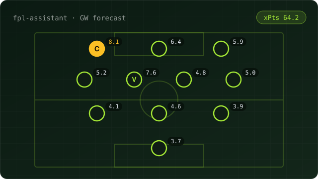
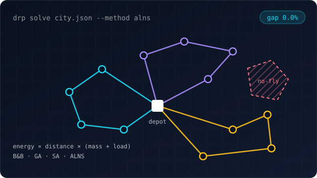
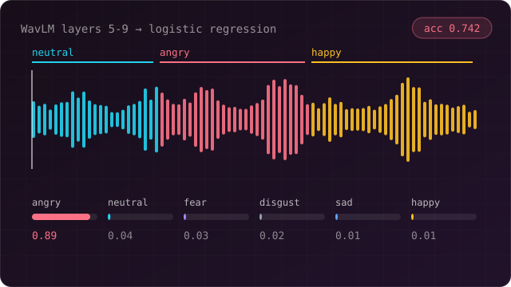
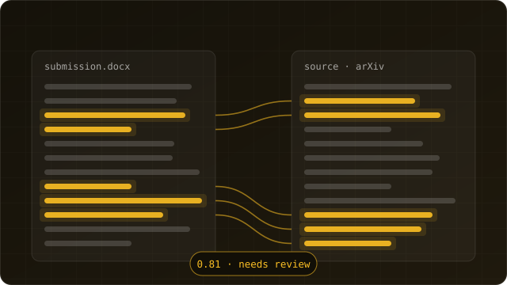
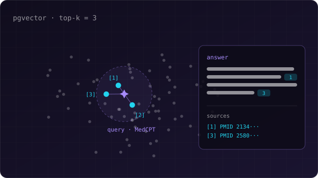
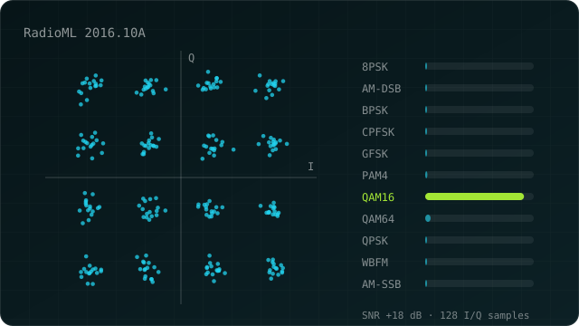
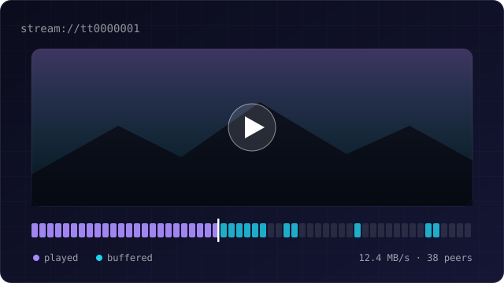
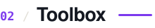

<a href="https://mohameddddt.github.io/">
  <picture>
    <source media="(prefers-color-scheme: dark)" srcset="assets/banner-dark.svg">
    
  </picture>
</a>

  
  
  
  

I'm in my fourth year at ENSIA, the National Higher School of Artificial Intelligence in Algiers, working mostly on machine learning, computer vision and NLP. I like projects that end in something you can use: a forecast you can pick a fantasy team with, a route planner you can watch fly, a music player on your phone. I also care about honest evaluation, so most of the numbers below come from data the models never saw.

 

<picture>
  <source media="(prefers-color-scheme: dark)" srcset="assets/h-work-dark.svg">
  
</picture>

<table>
  <tr>
    <td width="50%" valign="top">
      
      <h3>FPL Assistant</h3>
      Forecasts every Fantasy Premier League player's points for the next gameweek, then turns the forecasts into squads, transfers and captain picks.
      
<b>+0.12 to +0.15 R²</b> over a five-match average on 50,000 held-out matches · Python · LightGBM

      <a href="https://fpl-assistant-ten.vercel.app">Live</a> · <a href="https://github.com/mohameddddt/fpl-assistant">Code</a>
    </td>
    <td width="50%" valign="top">
      
      <h3>Drone Delivery Optimization</h3>
      Routes drones whose battery drain depends on the weight still on board: exact Branch &amp; Bound, GA / SA / ALNS, detours around no-fly zones, and a planner that replays the flight.
      
<b>624 tests</b>, 74 published CVRPLIB optima reproduced exactly · Python

      <a href="https://github.com/mohameddddt/Drone-Based-Delivery-Optimization-Problem">Code</a>
    </td>
  </tr>
  <tr>
    <td width="50%" valign="top">
      
      <h3>Speech Emotion Recognition</h3>
      Hears which of six emotions a spoken sentence carries, tested on voices the model never trained on. Hand-crafted acoustic features against a frozen WavLM encoder.
      
<b>74% accuracy</b> speaker-independent, vs 53% for the classical ensemble and 17% chance · PyTorch

      <a href="https://github.com/mohameddddt/Speech-Emotion-Recognition">Code</a> · 
    </td>
    <td width="50%" valign="top">
      
      <h3>Plagiarism Detection System</h3>
      Flags likely plagiarism passage by passage in CS and engineering writing, shows the source behind every flag, and never presents a score as proof.
      
BM25 retrieval, passage alignment, paraphrase scoring · Python · spaCy · FastAPI

      <a href="https://github.com/mohameddddt/PlagiarismDetectionSystem">Code</a>
    </td>
  </tr>
  <tr>
    <td width="50%" valign="top">
      
      <h3>Clinical Evidence QA</h3>
      Answers clinical questions from PubMed abstracts and cites the sources every answer rests on, from a Flutter app.
      
MedCPT embeddings · Supabase pgvector · Node.js · Flutter

      <a href="https://github.com/mohameddddt/Medical-literature-RAG-system">Code</a>
    </td>
    <td width="50%" valign="top">
      
      <h3>Automatic Modulation Classification</h3>
      Tells which of 11 modulation schemes a radio signal uses from raw I/Q samples, from a VT-CNN2 baseline to stronger deep models, on a leakage-free split.
      
RadioML 2016.10A · PyTorch · Kaggle GPUs

      <a href="https://github.com/mohameddddt/amc-wireless-communication">Code</a>
    </td>
  </tr>
  <tr>
    <td width="50%" valign="top">
      
      <h3>Cadence</h3>
      An Android music player and library manager: gapless local playback, fingerprint tagging with AcoustID and MusicBrainz, cover art, synced lyrics and scrobbling.
      
Flutter · Kotlin plugins

      <a href="https://github.com/mohameddddt/Cadence">Code</a>
    </td>
    <td width="50%" valign="top">
      
      <h3>Streamline</h3>
      A desktop movie and TV player that speaks the Stremio addon protocol and starts playback long before a download finishes.
      
Electron · React · TypeScript

      <a href="https://github.com/mohameddddt/Streamline">Code</a>
    </td>
  </tr>
</table>

Also: <a href="https://github.com/mohameddddt/eo-benchmark-hub">EO-Benchmark Hub</a>, a leaderboard for Earth-observation models · <a href="https://github.com/mohameddddt/Jerd">Jerd</a>, offline-first stock control for a small shop · <a href="https://github.com/mohameddddt/SomaTrack-Predicting-Study-Related-Physical-Ailments">SomaTrack</a>, predicting study-related aches from students' habits

  

<picture>
  <source media="(prefers-color-scheme: dark)" srcset="assets/h-toolbox-dark.svg">
  
</picture>

  <picture>
    <source media="(prefers-color-scheme: dark)" srcset="https://skillicons.dev/icons?i=py,pytorch,tensorflow,sklearn,ts,js,dart,kotlin,cpp,java&perline=10&theme=dark">
    
  </picture>
   
  <picture>
    <source media="(prefers-color-scheme: dark)" srcset="https://skillicons.dev/icons?i=react,nextjs,nodejs,fastapi,flask,flutter,electron,postgres,supabase,docker&perline=10&theme=dark">
    
  </picture>

Models first: gradient boosting, deep learning for audio, signals and text, retrieval and optimisation. Then whatever the model needs to be useful, on the web, mobile or desktop. I speak Arabic, French and English.

 

<picture>
  <source media="(prefers-color-scheme: dark)" srcset="assets/h-activity-dark.svg">
  
</picture>

<picture>
  <source media="(prefers-color-scheme: dark)" srcset="https://raw.githubusercontent.com/mohameddddt/mohameddddt/output/profile-3d-contrib/profile-night-rainbow.svg">
  
</picture>

 

<picture>
  <source media="(prefers-color-scheme: dark)" srcset="assets/h-hello-dark.svg">
  
</picture>

The quickest way to reach me is [mohamed.sahnoune.toubal@ensia.edu.dz](mailto:mohamed.sahnoune.toubal@ensia.edu.dz), or on [LinkedIn](https://www.linkedin.com/in/mohamed-sahnoune-toubal/). More about me and my work is on my [portfolio](https://mohameddddt.github.io/).
